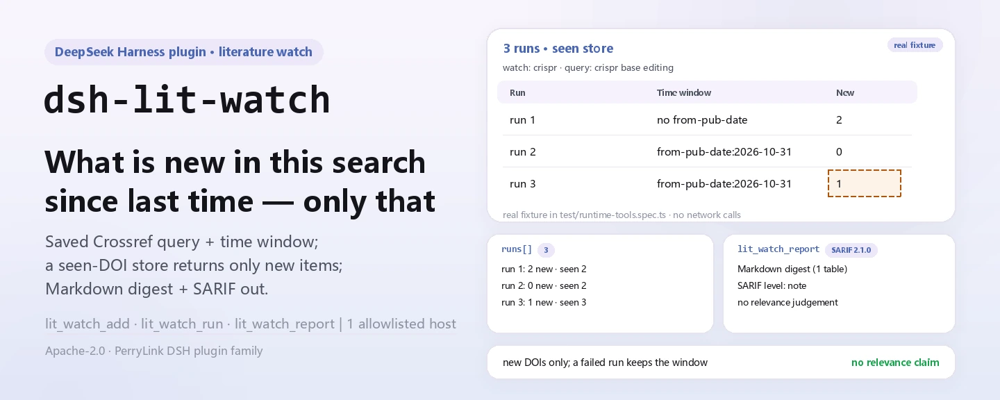
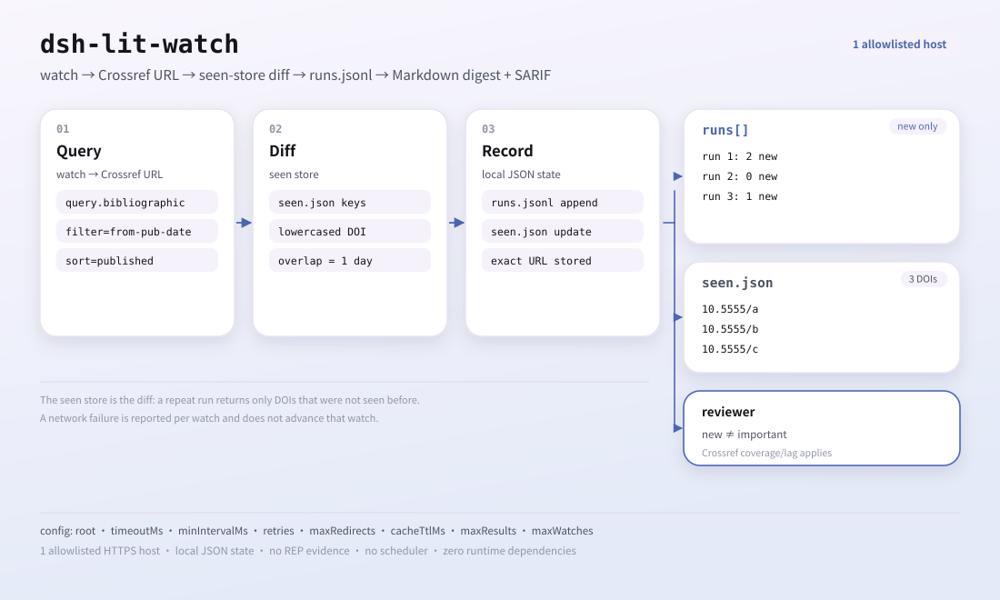
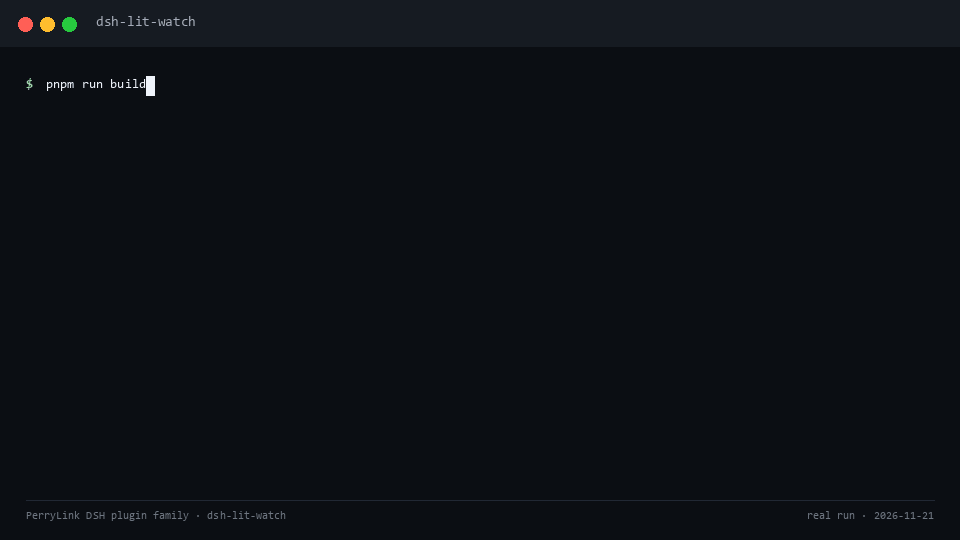

<div align="center">

<picture>
  <source media="(prefers-color-scheme: dark)" srcset="docs/assets/dsh-lit-watch-hero-en-dark.webp">
  
</picture>

# dsh-lit-watch

**Qué hay de nuevo en esta búsqueda desde la última vez — y solo eso.**

*Consultas bibliográficas de Crossref guardadas con ventanas temporales, un almacén de DOI vistos para que las ejecuciones repetidas devuelvan solo elementos realmente nuevos, y un resumen Markdown + SARIF.*

[English](README.md) · [简体中文](README-zh.md) · [Español](README-es.md) · [Português](README-pt.md) · [हिन्दी](README-hi.md)

[](LICENSE)
[]()

</div>

---

## Qué hace

- **`lit_watch_add`** — guarda un watch con nombre: una cadena `query.bibliographic` de Crossref, filtros adicionales opcionales (`type:journal-article`), una fecha `since` fija y un número de filas.
- **`lit_watch_run`** — consulta Crossref, conserva solo los DOI que no están en el almacén local de vistos, registra la URL exacta, avanza la ventana temporal y anexa a `runs.jsonl`. Un fallo de red se informa por watch y **no avanza** ese watch.
- **`lit_watch_report`** — resumen Markdown (una tabla por watch) + notas SARIF 2.1.0 para los elementos nuevos.

<picture>
  <source media="(prefers-color-scheme: dark)" srcset="docs/assets/dsh-lit-watch-flow-v5-dark.svg">
  
</picture>

*Estructura: consulta → diferencia → registro; `runs[]` y el resumen + SARIF son las dos salidas, y el almacén de vistos es lo que hace que una ejecución repetida devuelva solo elementos realmente nuevos. Las etiquetas de token dentro del diagrama son los nombres reales de herramientas y campos, así que la misma imagen sirve para los cinco idiomas.*

## Capacidad verificada del proveedor

`GET /works?query.bibliographic=…&filter=from-pub-date:…&rows=…&select=…` se verificó en vivo el 2026-11-08 (HTTP 200, `total-results` y elementos analizados). El plugin usa exactamente esta forma; la URL se guarda con cada ejecución para que se pueda reproducir un resumen.

## Qué no hace

- **Sin juicio de relevancia.** Un watch es una `ventana de fechas × consulta`; nuevo ≠ importante, y se aplican la cobertura y el retraso de Crossref.
- **Sin texto completo, sin resúmenes, sin recuentos de citas.** Solo los campos solicitados en `select`.
- **Sin alertas por correo/webhook.** Las ejecuciones las impulsa quien llama (el planificador del host o el usuario).
- **Sin fuentes distintas de Crossref.** Los watch de PubMed/arXiv/CNKI están fuera del alcance.
- **Sin evidencia REP.** El estado es JSON local (`watches.json`, `seen.json`, `runs.jsonl`), no un registro REP; se dice explícitamente en lugar de dejarlo implícito.

## Ventanas temporales

- Primera ejecución de un watch: sin `from-pub-date` a menos que el watch tenga `since`.
- Ejecuciones posteriores: `since = fecha de la última ejecución exitosa − 1 día` (solapamiento), para que no se pierda una publicación indexada tarde; el almacén de vistos elimina los duplicados del solapamiento.
- Una ejecución fallida deja `lastRunAt` intacto, así que la siguiente vuelve a cubrir el intervalo en lugar de saltárselo.

## Herramientas

### `lit_watch_add`

`{ name, query, filter?, since?, rows?, replace? }` → `{ ok, watch }`.

### `lit_watch_run`

`{ name?, fresh? }` → `{ ok, runs, totalNew, warnings }`.

### `lit_watch_report`

`{ runs? }` (por defecto: los últimos 50 del historial) → `{ ok, markdown, sarif }`.

### Códigos de error

Fallos de herramienta: `INVALID_INPUT` · `WATCH_UNKNOWN` · `WATCH_EXISTS` · `LIMIT` · `STORE_ERROR`.

Errores de ejecución por watch (dentro de `runs[].error`): `blocked_host` · `invalid_url` · `too_many_redirects` · `timeout` · `http_error` · `invalid_response` · `network_error`.

## Compatibilidad e instalación

| | |
|---|---|
| DeepSeek Harness | **`dsh-v0.2.3-alpha.1`** (verificado 2026-11-22); peer `>=0.2.1-0 <0.3.0 \|\| >=0.2.2-0 <0.3.0` |
| Node | `^22.19.0 \|\| >=24.9.0` (probado `24.22.1`), solo ESM |
| Peers | `@perrylink/dsh-research-core ^0.1.0`, `@deepseek-ai/cordis ^4.0.5-alpha.1`, `@deepseek-ai/dsh-tools`, `@deepseek-ai/schemastery ^3.18.5-alpha.1` |
| Dependencias en tiempo de ejecución | **cero** |

```sh
dsh plugin --profile <name> add @perrylink/dsh-research-core dsh-lit-watch
dsh --profile <name> --dump-config | grep dsh-lit-watch
```

> **Nota sobre los peers de la familia:** `@perrylink/dsh-research-core` se declara como peer para un contrato de instalación único y uniforme en toda la familia de investigación, aunque este paquete no lo importa en tiempo de ejecución.

## Configuración

| Clave | Valor por defecto | Significado |
|---|---|---|
| `enabled` | `true` | `false` no monta nada |
| `root` | `.lit-watch` | watches, almacén de vistos, historial de ejecuciones, caché |
| `userAgent` / `mailto` | `dsh-lit-watch/0.1.0 …` / — | grupo "polite" de Crossref |
| `timeoutMs` / `minIntervalMs` | `15000` / `150` | límites de la petición |
| `retries` / `maxRedirects` | `1` / `3` | reintentos/redirecciones acotados |
| `cacheTtlMs` | `21600000` | caché de respuestas de 6 h (`fresh` la omite) |
| `maxResults` / `maxWatches` | `100` / `50` | tope de filas y tope de watches |

## Límites de seguridad

- Solo HTTPS, lista de hosts exactos (`api.crossref.org`), redirecciones manuales revalidadas salto a salto.
- Sin credenciales en las URL, sin puertos personalizados; no se envía más dato de usuario que el texto de la consulta.
- Los estados no 2xx y los cuerpos no JSON hacen fallar el watch en lugar de tratarse como un resultado vacío; la caché de respuestas se indexa por el SHA-256 de la URL exacta.
- Los archivos de estado son JSON local; las escrituras solo ocurren bajo `root`.

## Evaluación



*Animado: stdout real de `pnpm run build` → `pnpm test` → `pnpm run verify:package` del propio repositorio (fixtures sin conexión, sin red; reejecutado el 2026-11-21). La suite pasa 31 pruebas en 5 archivos.*

**31 pruebas**: construcción de URL (consulta, filtro combinado, mailto), validación de fechas y nombres incluidas fechas de calendario imposibles, análisis de elementos (DOI/título obligatorios, año/revista/autores) y rechazo de respuestas malformadas, diff insensible a mayúsculas y minúsculas, deduplicación en tiempo de ejecución a lo largo de tres ejecuciones (2 → 0 → 1 nuevos) con avance de ventana, aciertos de caché por URL exacta, `fresh` que omite la caché y rechazo de cachear un cuerpo malformado, aislamiento local de fallos de red sin avance de ventana, reemplazo/desconocido/límites de watch, rechazo de almacén corrupto, resumen + historial, límites HTTP (lista de permitidos, revalidación de redirecciones salto a salto, tope de redirecciones, rechazo de no 2xx, reintento 429, timeout, limitación de tasa), esquemas de herramientas, add→run→report de extremo a extremo, ramas de fallo, contrato de plugin, contrato de paquete.

No se declara ningún benchmark: el valor es la corrección de la diferencia contra un almacén de vistos fijo, que las pruebas fijan; no hay un corpus etiquetado de relevancia.

## Limitaciones conocidas (v0.1)

- El ranking de `query.bibliographic` es de Crossref; un watch puede perder elementos relevantes que queden por debajo de `rows`.
- Sin filtros de ORCID/afiliación más allá del paso directo del `filter` de Crossref.
- Sin deduplicación por título (los registros sin DOI se omiten por diseño).
- El almacén de vistos crece con cada DOI nuevo; en v0.1 no hay poda automática.

## Licencia

Apache-2.0. Sin código de terceros en tiempo de ejecución.
