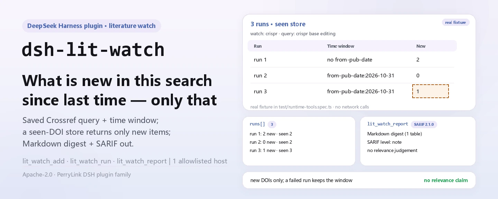
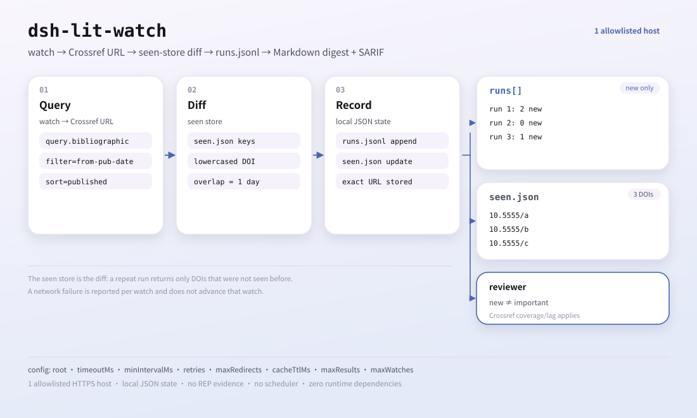
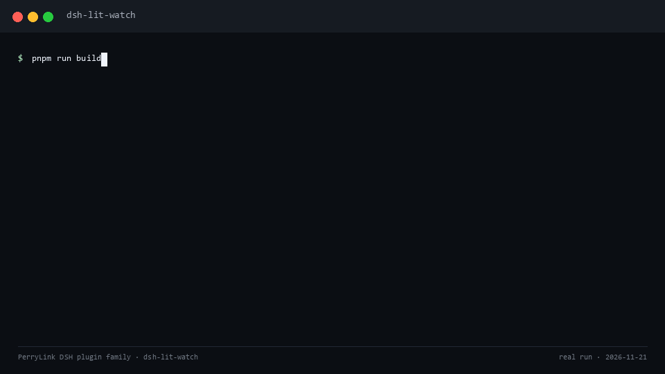

<div align="center">

<picture>
  <source media="(prefers-color-scheme: dark)" srcset="docs/assets/dsh-lit-watch-hero-en-dark.webp">
  
</picture>

# dsh-lit-watch

**इस खोज में पिछली बार से नया क्या है — और केवल वही।**

*समय विंडो के साथ सहेजी गई Crossref ग्रंथ-सूची क्वेरी, एक seen-DOI स्टोर ताकि दोहराए गए रन केवल वास्तव में नए आइटम लौटाएँ, और एक Markdown सारांश + SARIF।*

[English](README.md) · [简体中文](README-zh.md) · [Español](README-es.md) · [Português](README-pt.md) · [हिन्दी](README-hi.md)

[](LICENSE)
[]()

</div>

---

## यह क्या करता है

- **`lit_watch_add`** — एक नामित watch सहेजता है: एक Crossref `query.bibliographic` स्ट्रिंग, वैकल्पिक अतिरिक्त फ़िल्टर (`type:journal-article`), एक निश्चित `since` तिथि और पंक्तियों की संख्या।
- **`lit_watch_run`** — Crossref से क्वेरी करता है, केवल वे DOI रखता है जो स्थानीय seen स्टोर में नहीं हैं, सटीक URL दर्ज करता है, समय विंडो आगे बढ़ाता है और `runs.jsonl` में जोड़ता है। नेटवर्क विफलता प्रति watch रिपोर्ट होती है और उस watch को **आगे नहीं बढ़ाती**।
- **`lit_watch_report`** — Markdown सारांश (प्रति watch एक तालिका) + नए आइटम के लिए SARIF 2.1.0 नोट्स।

<picture>
  <source media="(prefers-color-scheme: dark)" srcset="docs/assets/dsh-lit-watch-flow-v5-dark.svg">
  
</picture>

*संरचना: क्वेरी → अंतर → रिकॉर्ड; `runs[]` और सारांश + SARIF दो आउटपुट हैं, और seen स्टोर ही वह चीज़ है जो दोहराए गए रन को केवल वास्तव में नए आइटम लौटाने देती है। डायग्राम के अंदर टोकन लेबल असली टूल और फ़ील्ड के नाम हैं, इसलिए एक ही चित्र पाँचों भाषाओं के लिए काम आता है।*

## सत्यापित प्रदाता क्षमता

`GET /works?query.bibliographic=…&filter=from-pub-date:…&rows=…&select=…` को 2026-11-08 को लाइव सत्यापित किया गया (HTTP 200, `total-results` और आइटम पार्स हुए)। प्लगइन बिल्कुल इसी रूप का उपयोग करता है; हर रन के साथ URL संग्रहीत होता है ताकि सारांश दोबारा बनाया जा सके।

## यह क्या नहीं करता

- **कोई प्रासंगिकता निर्णय नहीं।** एक watch एक `तिथि विंडो × क्वेरी` है; नया ≠ महत्वपूर्ण, और Crossref की कवरेज/देरी लागू होती है।
- **कोई पूर्ण पाठ, कोई सार, कोई उद्धरण गणना नहीं।** केवल `select` में माँगे गए फ़ील्ड।
- **कोई ईमेल/webhook अलर्ट नहीं।** रन कॉलर द्वारा संचालित होते हैं (होस्ट शेड्यूलर या उपयोगकर्ता)।
- **Crossref के अलावा कोई स्रोत नहीं।** PubMed/arXiv/CNKI watches दायरे से बाहर हैं।
- **कोई REP एविडेंस नहीं।** स्थिति स्थानीय JSON (`watches.json`, `seen.json`, `runs.jsonl`) है, REP रिकॉर्ड नहीं; यह स्पष्ट कहा गया है, जताया नहीं गया।

## समय विंडो

- किसी watch का पहला रन: `from-pub-date` नहीं, जब तक watch में `since` न हो।
- बाद के रन: `since = अंतिम सफल रन की तिथि − 1 दिन` (ओवरलैप), ताकि देर से इंडेक्स हुआ प्रकाशन छूटे नहीं; seen स्टोर ओवरलैप के डुप्लिकेट हटा देता है।
- विफल रन `lastRunAt` को अछूता छोड़ता है, इसलिए अगला रन अंतराल को छोड़ने के बजाय फिर से कवर करता है।

## टूल

### `lit_watch_add`

`{ name, query, filter?, since?, rows?, replace? }` → `{ ok, watch }`.

### `lit_watch_run`

`{ name?, fresh? }` → `{ ok, runs, totalNew, warnings }`.

### `lit_watch_report`

`{ runs? }` (डिफ़ॉल्ट: इतिहास से अंतिम 50) → `{ ok, markdown, sarif }`.

### त्रुटि कोड

टूल विफलताएँ: `INVALID_INPUT` · `WATCH_UNKNOWN` · `WATCH_EXISTS` · `LIMIT` · `STORE_ERROR`.

प्रति-watch रन त्रुटियाँ (`runs[].error` के अंदर): `blocked_host` · `invalid_url` · `too_many_redirects` · `timeout` · `http_error` · `invalid_response` · `network_error`.

## अनुकूलता और इंस्टॉल

| | |
|---|---|
| DeepSeek Harness | **`dsh-v0.2.3-alpha.1`** (सत्यापित 2026-11-22); peer `>=0.2.1-0 <0.3.0 \|\| >=0.2.2-0 <0.3.0` |
| Node | `^22.19.0 \|\| >=24.9.0` (`24.22.1` पर परीक्षित), केवल ESM |
| Peers | `@perrylink/dsh-research-core ^0.1.0`, `@deepseek-ai/cordis ^4.0.5-alpha.1`, `@deepseek-ai/dsh-tools`, `@deepseek-ai/schemastery ^3.18.5-alpha.1` |
| रनटाइम निर्भरताएँ | **शून्य** |

```sh
dsh plugin --profile <name> add @perrylink/dsh-research-core dsh-lit-watch
dsh --profile <name> --dump-config | grep dsh-lit-watch
```

> **परिवार-व्यापी peer नोट:** `@perrylink/dsh-research-core` को पूरे रिसर्च परिवार में एक ही, एकरूप इंस्टॉल अनुबंध के लिए peer के रूप में घोषित किया गया है, भले ही यह पैकेज रनटाइम पर उसे इम्पोर्ट नहीं करता।

## कॉन्फ़िगरेशन

| कुंजी | डिफ़ॉल्ट | अर्थ |
|---|---|---|
| `enabled` | `true` | `false` कुछ भी माउंट नहीं करता |
| `root` | `.lit-watch` | watches, seen स्टोर, रन इतिहास, कैश |
| `userAgent` / `mailto` | `dsh-lit-watch/0.1.0 …` / — | Crossref polite pool |
| `timeoutMs` / `minIntervalMs` | `15000` / `150` | अनुरोध सीमाएँ |
| `retries` / `maxRedirects` | `1` / `3` | सीमित पुनः प्रयास/रीडायरेक्ट |
| `cacheTtlMs` | `21600000` | 6 घंटे का रिस्पॉन्स कैश (`fresh` इसे बायपास करता है) |
| `maxResults` / `maxWatches` | `100` / `50` | पंक्ति सीमा और watch सीमा |

## सुरक्षा सीमाएँ

- केवल HTTPS, सटीक-होस्ट अनुमति सूची (`api.crossref.org`), मैनुअल रीडायरेक्ट हर हॉप पर फिर से सत्यापित।
- URL में कोई क्रेडेंशियल नहीं, कोई कस्टम पोर्ट नहीं; क्वेरी टेक्स्ट के अलावा कोई उपयोगकर्ता डेटा नहीं भेजा जाता।
- गैर-2xx स्थितियाँ और गैर-JSON बॉडी watch को विफल करती हैं, खाली परिणाम नहीं मानी जातीं; रिस्पॉन्स कैश सटीक URL के SHA-256 से कुंजीबद्ध है।
- watch फ़ाइलें स्थानीय JSON हैं; लेखन केवल `root` के अंतर्गत होता है।

## मूल्यांकन



*एनिमेटेड: रिपॉज़िटरी के अपने `pnpm run build` → `pnpm test` → `pnpm run verify:package` का वास्तविक stdout (ऑफ़लाइन fixture, कोई नेटवर्क नहीं; 2026-11-21 को पुनः चलाया गया)। सूट 5 फ़ाइलों में 31 परीक्षण पास करता है।*

**31 परीक्षण**: URL निर्माण (क्वेरी, संयुक्त फ़िल्टर, mailto), तिथि/नाम सत्यापन जिसमें असंभव कैलेंडर तिथियाँ भी शामिल हैं, आइटम पार्सिंग (DOI/शीर्षक आवश्यक, वर्ष/पत्रिका/लेखक) और विकृत रिस्पॉन्स की अस्वीकृति, केस-असंवेदनशील अंतर, तीन रनों में रनटाइम डीडुप (2 → 0 → 1 नए) विंडो उन्नयन के साथ, सटीक-URL कैश हिट, `fresh` बायपास और विकृत बॉडी को कैश करने से इनकार, विंडो उन्नयन के बिना स्थानीय नेटवर्क-विफलता अलगाव, watch प्रतिस्थापन/अज्ञात/सीमाएँ, भ्रष्ट स्टोर की अस्वीकृति, सारांश + इतिहास, HTTP सीमाएँ (अनुमति सूची, प्रति-हॉप रीडायरेक्ट पुनः सत्यापन, रीडायरेक्ट सीमा, गैर-2xx अस्वीकृति, 429 पुनः प्रयास, timeout, थ्रॉटल), टूल स्कीमा, add→run→report एंड-टू-एंड, विफलता शाखाएँ, प्लगइन अनुबंध, पैकेज अनुबंध।

कोई बेंचमार्क का दावा नहीं: मूल्य एक निश्चित seen स्टोर के विरुद्ध अंतर की शुद्धता है, जिसे परीक्षण पिन करते हैं; कोई लेबल किया गया प्रासंगिकता कॉर्पस नहीं है।

## ज्ञात सीमाएँ (v0.1)

- `query.bibliographic` की रैंकिंग Crossref की है; एक watch उन प्रासंगिक आइटम चूक सकता है जो `rows` से नीचे रैंक होते हैं।
- कच्चे Crossref `filter` पास-थ्रू के अलावा कोई ORCID/संबद्धता फ़िल्टर नहीं।
- शीर्षक से कोई डीडुप नहीं (DOI-रहित रिकॉर्ड डिज़ाइन से छोड़े जाते हैं)।
- seen स्टोर हर नए DOI के साथ बढ़ता है; v0.1 में कोई स्वचालित प्रूनिंग नहीं।

## लाइसेंस

Apache-2.0. कोई तृतीय-पक्ष रनटाइम कोड नहीं।
