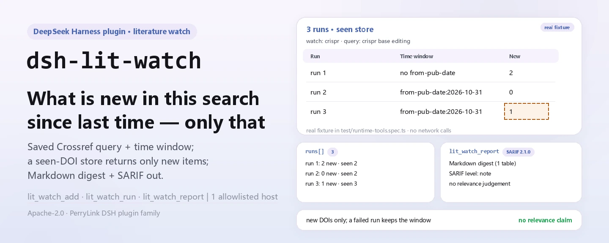
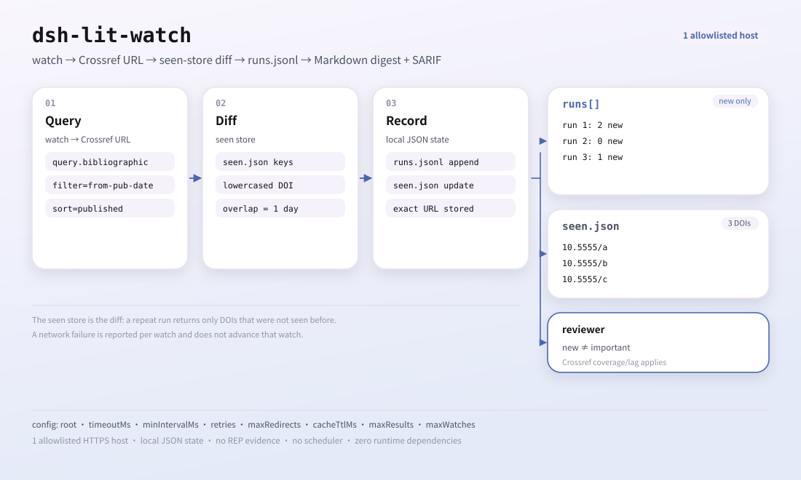
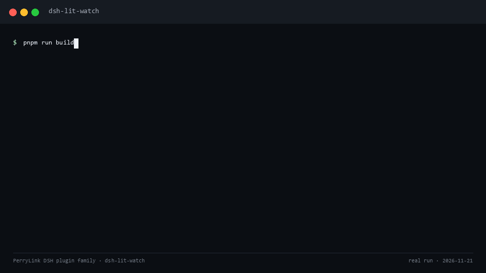

<div align="center">

<picture>
  <source media="(prefers-color-scheme: dark)" srcset="docs/assets/dsh-lit-watch-hero-en-dark.webp">
  
</picture>

# dsh-lit-watch

**O que há de novo nesta busca desde a última vez — e apenas isso.**

*Consultas bibliográficas do Crossref salvas com janelas de tempo, um armazenamento de DOI vistos para que execuções repetidas devolvam apenas itens realmente novos, e um resumo Markdown + SARIF.*

[English](README.md) · [简体中文](README-zh.md) · [Español](README-es.md) · [Português](README-pt.md) · [हिन्दी](README-hi.md)

[](LICENSE)
[]()

</div>

---

## O que ele faz

- **`lit_watch_add`** — salva um watch nomeado: uma string `query.bibliographic` do Crossref, filtros extras opcionais (`type:journal-article`), uma data `since` fixa e um número de linhas.
- **`lit_watch_run`** — consulta o Crossref, mantém apenas os DOI que não estão no armazenamento local de vistos, registra a URL exata, avança a janela de tempo e anexa a `runs.jsonl`. Uma falha de rede é informada por watch e **não avança** esse watch.
- **`lit_watch_report`** — resumo Markdown (uma tabela por watch) + notas SARIF 2.1.0 para itens novos.


<picture>
  <source media="(prefers-color-scheme: dark)" srcset="docs/assets/dsh-lit-watch-flow-v5-dark.svg">
  
</picture>

*Estrutura: consulta → diferença → registro; `runs[]` e o resumo + SARIF são as duas saídas, e o armazenamento de vistos é o que faz uma execução repetida devolver apenas itens realmente novos. Os rótulos de token dentro do diagrama são os nomes reais de ferramentas e campos, então a mesma imagem serve aos cinco idiomas.*

## Capacidade verificada do provedor

`GET /works?query.bibliographic=…&filter=from-pub-date:…&rows=…&select=…` foi verificado ao vivo em 2026-11-08 (HTTP 200, `total-results` e itens analisados). O plugin usa exatamente esta forma; a URL é guardada a cada execução para que um resumo possa ser reproduzido.

## O que ele não faz

- **Sem julgamento de relevância.** Um watch é uma `janela de datas × consulta`; novo ≠ importante, e a cobertura/atraso do Crossref se aplicam.
- **Sem texto completo, sem resumos, sem contagens de citações.** Apenas os campos pedidos em `select`.
- **Sem alertas por e-mail/webhook.** As execuções são conduzidas por quem chama (agendador do host ou usuário).
- **Sem fontes além do Crossref.** Watches de PubMed/arXiv/CNKI estão fora do escopo.
- **Sem evidência REP.** O estado é JSON local (`watches.json`, `seen.json`, `runs.jsonl`), não um registro REP; isso é dito em vez de subentendido.

## Janelas de tempo

- Primeira execução de um watch: sem `from-pub-date`, a menos que o watch tenha `since`.
- Execuções seguintes: `since = data da última execução bem-sucedida − 1 dia` (sobreposição), para que uma publicação indexada tarde não seja perdida; o armazenamento de vistos remove os duplicados da sobreposição.
- Uma execução com falha deixa `lastRunAt` intacto, então a próxima cobre o intervalo de novo em vez de pulá-lo.

## Ferramentas

### `lit_watch_add`

`{ name, query, filter?, since?, rows?, replace? }` → `{ ok, watch }`.

### `lit_watch_run`

`{ name?, fresh? }` → `{ ok, runs, totalNew, warnings }`.

### `lit_watch_report`

`{ runs? }` (padrão: as últimas 50 do histórico) → `{ ok, markdown, sarif }`.

### Códigos de erro

Falhas de ferramenta: `INVALID_INPUT` · `WATCH_UNKNOWN` · `WATCH_EXISTS` · `LIMIT` · `STORE_ERROR`.

Erros de execução por watch (dentro de `runs[].error`): `blocked_host` · `invalid_url` · `too_many_redirects` · `timeout` · `http_error` · `invalid_response` · `network_error`.

## Compatibilidade e instalação

| | |
|---|---|
| DeepSeek Harness | **`dsh-v0.2.2-rc.4`** (verificado 2026-11-18); peer `>=0.2.1-0 <0.3.0 \|\| >=0.2.2-0 <0.3.0` |
| Node | `^22.19.0 \|\| >=24.9.0` (testado `24.22.1`), somente ESM |
| Peers | `@perrylink/dsh-research-core ^0.1.0`, `@deepseek-ai/cordis ^4.0.5-alpha.1`, `@deepseek-ai/dsh-tools`, `@deepseek-ai/schemastery ^3.18.5-alpha.1` |
| Dependências em tempo de execução | **zero** |

```sh
dsh plugin --profile <name> add @perrylink/dsh-research-core dsh-lit-watch
dsh --profile <name> --dump-config | grep dsh-lit-watch
```


> **Nota sobre os peers da família:** `@perrylink/dsh-research-core` é declarado como peer para um contrato de instalação único e uniforme em toda a família de pesquisa, embora este pacote não o importe em tempo de execução.

## Configuração

| Chave | Valor padrão | Significado |
|---|---|---|
| `enabled` | `true` | `false` não monta nada |
| `root` | `.lit-watch` | watches, armazenamento de vistos, histórico de execuções, cache |
| `userAgent` / `mailto` | `dsh-lit-watch/0.1.0 …` / — | grupo "polite" do Crossref |
| `timeoutMs` / `minIntervalMs` | `15000` / `150` | limites da requisição |
| `retries` / `maxRedirects` | `1` / `3` | novas tentativas/redirecionamentos limitados |
| `cacheTtlMs` | `21600000` | cache de respostas de 6 h (`fresh` a ignora) |
| `maxResults` / `maxWatches` | `100` / `50` | teto de linhas e teto de watches |

## Limites de segurança

- Somente HTTPS, lista de hosts exatos (`api.crossref.org`), redirecionamentos manuais revalidados salto a salto.
- Sem credenciais nas URLs, sem portas personalizadas; nenhum dado de usuário além do texto da consulta é enviado.
- Status não 2xx e corpos não JSON fazem o watch falhar em vez de serem tratados como resultado vazio; o cache de respostas é indexado pelo SHA-256 da URL exata.
- Os arquivos de estado são JSON local; as gravações ocorrem somente sob `root`.

## Avaliação



*Animado: stdout real de `pnpm run build` → `pnpm test` → `pnpm run verify:package` do próprio repositório (fixtures offline, sem rede; reexecutado em 2026-11-21). A suíte passa 31 testes em 5 arquivos.*


**31 testes**: construção de URL (consulta, filtro combinado, mailto), validação de datas e nomes incluindo datas de calendário impossíveis, análise de itens (DOI/título obrigatórios, ano/periódico/autores) e rejeição de respostas malformadas, diff insensível a maiúsculas e minúsculas, deduplicação em tempo de execução ao longo de três execuções (2 → 0 → 1 novos) com avanço de janela, acertos de cache por URL exata, `fresh` que ignora o cache e recusa de cachear um corpo malformado, isolamento local de falhas de rede sem avanço de janela, substituição/desconhecido/limites de watch, recusa de armazenamento corrompido, resumo + histórico, limites HTTP (lista de permitidos, revalidação de redirecionamentos salto a salto, teto de redirecionamentos, rejeição de não 2xx, nova tentativa 429, timeout, limitação de taxa), esquemas de ferramentas, add→run→report de ponta a ponta, ramos de falha, contrato do plugin, contrato do pacote.

Nenhum benchmark é alegado: o valor é a correção da diferença contra um armazenamento de vistos fixo, que os testes fixam; não há corpus de relevância rotulado.

## Limitações conhecidas (v0.1)

- O ranking de `query.bibliographic` é do Crossref; um watch pode perder itens relevantes que fiquem abaixo de `rows`.
- Sem filtros de ORCID/afiliação além do repasse direto do `filter` do Crossref.
- Sem deduplicação por título (registros sem DOI são ignorados por design).
- O armazenamento de vistos cresce com cada DOI novo; na v0.1 não há poda automática.

## Licença

Apache-2.0. Sem código de terceiros em tempo de execução.
